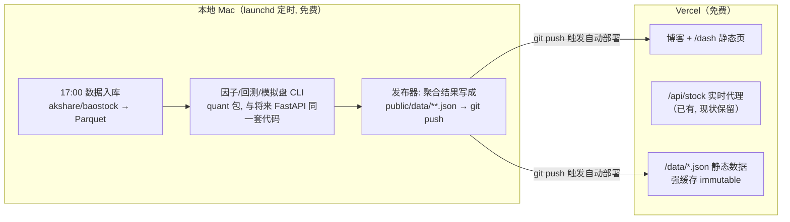
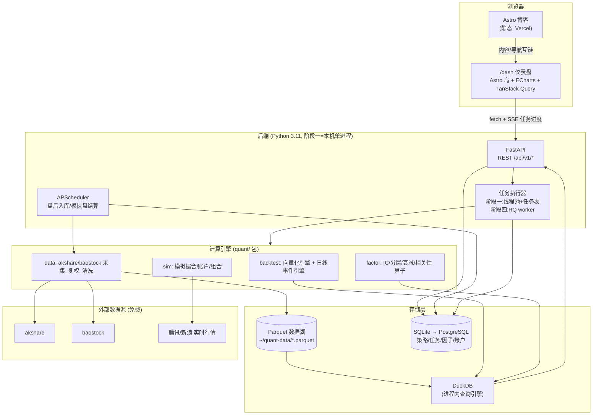

# 量化平台规划书 —— 从 astro-blog 到"个人版聚宽"

> 定稿前提（已确认）：**A股为主 · 先自己用后开放注册 · 暂时零预算本地跑 · Python/FastAPI 后端**
> 博客地址：blog.halo26812.eu.org（Astro Pure 主题，Vercel 静态部署）

---

## 0. 一页速览（TL;DR）

| 维度 | 决策 | 理由 |
|---|---|---|
| 前端 | 保留 Astro 博客 + 新增 `/dash` 仪表盘岛区 | 博客就是内容营销与流量入口，Astro 岛架构天然适合"文档页+交互页"混合 |
| 后端 | Python 3.11 + FastAPI | 回测/因子生态全在 Python，你的 `scripts/article_core_*.py` 全是现成弹药 |
| 行情数据 | akshare（主）+ baostock（备） | 都免费；tushare pro 等以后需要分钟线/财务精度再买 |
| 市场数据存储 | Parquet 数据湖 + DuckDB | 零预算单机最优解：不装数据库服务器，列存分析性能够跑全A日线10年 |
| 元数据存储 | SQLite（阶段一）→ PostgreSQL（开放注册时） | 策略、任务、账户等小表用 SQLite 即可，schema 按 PG 兼容写法留迁移路 |
| 任务执行 | 先 API 进程内线程池 → 后 Redis + RQ/Celery worker | 单用户不需要真队列；进程内跑+写任务表就能看进度 |
| 调度 | APScheduler（进程内）→ 上云后独立 scheduler 容器 | 盘后入库、每日模拟盘结算都是 cron 型任务 |
| 暴露方式 | 阶段零不需要暴露后端（发布静态 JSON）；升级期 Tailscale Funnel / Cloudflare Quick Tunnel | 零预算远程访问本地后端 |
| 图表 | ECharts（K线、热力图、净值曲线全用它） | 免费、国内生态好、Astro 岛里按需加载 |
| 部署 | 博客留 Vercel；后端本地 launchd/PM2；上云时 Docker Compose 单机全家桶 | 渐进式，每一步都有可用品 |

**里程碑主线**：M0 数据管道 → M1 因子看板（向量化回测）→ M2 策略回测引擎 → M3 模拟实盘 → M4 用户系统与上云。按业余时间（每周 10~15h）估算，全程约 **3~4 个月**，每个里程碑都有独立可用的产出。

---

## 0.5 阶段零：无后端冷启动模式（零预算现状下的执行版本）

### 先纠正两个前提

1. **你已经有免费后端**：`src/pages/api/stock.ts`（`prerender = false`）已经作为 Vercel Serverless 函数在生产运行，承担实时行情的 CORS/GBK 代理。Vercel Hobby 免费额度（100GB 流量/月、函数默认 10s、`maxDuration` 可到 60s）足够撑起"实时报价 + 静态数据分发"。
2. **本地跑 Python 不花钱**：数据入库、因子计算、回测、模拟盘结算全部在你自己的 Mac 上用 launchd 定时跑，这是"零预算"阶段真正的算力中心。国内网络访问东财/腾讯/新浪数据源也最快最稳。

### 架构：预计算 → 静态发布 → 前端直读



| 原架构组件 | 阶段零的免费替身 |
|---|---|
| FastAPI API 服务 | 不需要——`/dash` 页面 fetch `public/data/` 下的静态 JSON |
| 任务队列 + SSE 进度 | 不需要——回测在本地 CLI 跑完才发布，页面只见成品 |
| APScheduler 盘后任务 | macOS launchd 定时跑 CLI（`StartCalendarInterval` 17:00） |
| 模拟盘盘中轮询 | launchd 每 5 分钟跑一次估值脚本，重写 `nav.json` |
| DuckDB 查询服务 | 查询在本地脚本内完成，Vercel 上只放"展示级"聚合 JSON |
| GitHub Actions（可选） | 定时构建兜底、数据校验、失效告警（注意 runner 是海外 IP，见下） |

### 三条工程纪律（决定这条路能不能走远）

1. **`quant/` 包不感知"发布"**：所有 CLI 只做"读 Parquet → 算 → 往 `dist/data/` 写 JSON"。将来上 FastAPI 时，同一批函数换成 API handler，**零重写**。这就是为什么阶段零的代码完全不算弃子。
2. **发布"展示级"载荷，不发布原始数据**：全市场日线 JSON 绝不过网（100GB 流量会爆），每个页面一个聚合 JSON（K线 250 根、榜单 top50、因子 IC 序列日频），单文件控制在 500KB 内，文件名带内容 hash 或按日期分文件配 `immutable` 缓存。
3. **数据与代码可分离**：JSON 发布建议放独立 `data/` 目录（同 repo 或独立 data repo），`.gitignore` 管好 Parquet 绝不进库。

### 已知坑（你在 stock.ts 注释里已经踩过）

- 东财 push2 对海外 IP（Vercel/GH runner）不可达 → **凡走国内数据源的抓取一律本地 Mac 跑**，Actions 只做构建触发与校验。
- Vercel 函数 10~60s 超时 → "网页上写策略点运行"这种在线回测在阶段零**不提供**，回测报告 = 本地跑完发布出来的静态报告页。

### 什么时候升级（触发条件，不提前做）

| 触发条件 | 升级到 | 成本 |
|---|---|---|
| 想在线编辑策略/秒级交互/开放注册 | FastAPI 本地跑（原阶段一），Tailscale Funnel 自用 | 仍然 0 元 |
| 需要 7×24 常驻服务、他人可访问 | **Oracle Cloud Always Free**（ARM 4核24G 永久免费 VPS，注册需信用卡验证）跑 Docker Compose 全家桶 | 0 元（有验证门槛，海外节点） |
| 免费额度真撞墙 / 要国内低延迟 | 国内轻量服务器 4C8G | ~100 元/月 |

**结论：零预算不砍任何里程碑，只砍"在线运行策略"这一个交互形态。M0~M3 全部照常交付，代码从第一天就是将来后端的内核。**

---

## 1. 现状盘点：你已经有什么

不要小看仓库里这些资产，它们是新平台的"半成品零件库"：

| 现有资产 | 位置 | 在新平台中的去向 |
|---|---|---|
| 数百个量化研究脚本（因子回归、Bootstrap、HMM、GARCH、波动率模型…） | `scripts/article_core_*.py`、`bds_core.py` 等 | **因子库种子**。抽出其中 IC 计算、分位分组、净值统计等公共函数，沉淀为 `quant/factor/` 标准算子；每个脚本改造成一个"示例因子+示例策略" |
| 文章结果 JSON（stats.json / results.json，2000+ 份） | `public/images/*/stats.json` | 结构化回测指标的历史数据，可灌入 `backtest_run` 表做"研究档案"页 |
| 股票实时查询页 + 自选列表 | `src/pages/stock.astro`、`src/components/stock/StockQuote.astro` | **股票看板 v0**。它已在调免费实时行情接口，升级为个股详情页的实时报价组件 |
| 量化专栏页 | `src/pages/quant-column.astro` | 与新仪表盘导航打通，文章↔因子↔回测互相链接 |
| 数学公式渲染 | KaTeX 已配好 | 因子说明文档页直接写 LaTeX |
| 评论系统 | Waline | 开放注册期的用户反馈通道 |
| Vercel 部署链路 | `.vercel/`、GitHub Actions | 继续承担博客发布 |

**缺口**（本项目全部没有，需新建）：数据库、行情数据获取与存储、回测引擎、任务调度、鉴权、服务端 API。

---

## 2. 目标形态与范围裁剪

聚宽的全景是：数据 API + 研究环境(笔记本) + 回测 + 模拟盘 + 实盘对接 + 因子库 + 社区 + 平台运营。**个人项目必须砍**：

- ❌ 实盘券商对接（合规红线，永远不碰，"模拟实盘"到纸面交易为止）
- ❌ Jupyter 在线研究环境（用本地 Jupyter/脚本代替，成本高收益低）
- ❌ 分钟级/tick 级回测（起步只做**日线**，分钟线是数据量与撮合复杂度的十倍陷阱）
- ❌ 社区/文章点赞/积分体系（博客就是社区）
- ⏸️ 因子看板、股票看板：先做，但先只服务自己
- ⏸️ 注册登录：M4 才做，但表结构第一天就带 `user_id`

最终 MVP 形态：**登录后能看到 股票看板 / 因子看板 / 写策略跑回测看报告 / 模拟盘每日自动跑并出日报**。

---

## 3. 总体架构



关键原则：

1. **计算引擎 `quant/` 是纯 Python 包**，不依赖 FastAPI——本地 Jupyter、CLI、API、worker 四个入口共享同一套代码。这是从"一次性脚本"升级成"平台"最重要的一条架构纪律。
2. **博客与仪表盘同源不同命**：博客页保持静态（SEO、免费托管），仪表盘页是 Astro 岛，运行时 fetch 后端 API。
3. **一切长任务走任务表**：回测、全市场因子计算都记录为 `job` 行（状态机：`pending→running→success/failed`），前端轮询或 SSE。今天用线程池实现，将来无痛换成 RQ/Celery。

---

## 4. 技术选型明细

| 层 | 选型 | 版本建议 | 备选与否决理由 |
|---|---|---|---|
| Web 框架 | FastAPI + pydantic v2（阶段一启用，阶段零不部署任何后端，见 0.5） | ≥0.115 | NestJS/Hono：回测生态不在 TS 侧，否决 |
| 数据采集 | akshare | 每月跟新版（接口常变，锁版本+适配层） | tushare pro：免费额度低；baostock 做日线备份源 |
| 存储-行情 | pyarrow + Parquet + DuckDB | duckdb ≥1.0 | ClickHouse：上云多用户再考虑；MySQL：列存分析弱 |
| 存储-元数据 | SQLModel（SQLAlchemy 2.x）+ SQLite | — | 纯 PG 起步：本地装库麻烦；SQLModel 同时兼容 PG |
| ORM/迁移 | Alembic | — | 直接建表：迁移失控 |
| 数值 | numpy / pandas / polars(可选) | — | 你已熟练 |
| 绩效 | 自研 `quant/metrics.py`（年化/Sharpe/回撤/Calmar/换手） | — | `empyrical` 停维护且偏美股假设（T+1/涨跌停要自己写） |
| 调度 | APScheduler 3.x | — | 系统 cron：无法与任务表联动 |
| 实时行情 | 腾讯 `qt.gtimg.cn` / 新浪 hq 接口 | — | 你 stock.astro 已验证可用 |
| 图表 | echarts + vue-echarts（或直接裸 echarts） | ≥5.5 | ECharts 官网 A股 K线 demo 直接抄；Lightweight-Charts 备选 |
| 前端数据请求 | TanStack Query（QueryClient + useQuery） | — | 裸 fetch：缓存/重试/轮询都要重造 |
| 鉴权（M4） | fastapi-users + JWT | — | 自建：重复造轮子 |
| 包管理 | uv（Python）/ bun（前端） | — | 你已在用 bun |
| 容器化（M4） | Docker Compose 单机 | — | K8s：自杀式选型 |

**Python 版本注意**：本机系统 Python 是 3.9.6 且没装 pandas（你平时应该另有环境）。新后端统一用 **Python 3.11 + uv 虚拟环境**，akshare/pandas 新版对 3.9 的支持会逐渐掉队。

---

## 5. 数据层设计（整个平台的地基）

### 5.1 数据源分工

| 数据 | 主源 | 备源 | 更新时机 |
|---|---|---|---|
| A股股票列表/退市状态 | akshare `stock_info_a_code_name` | baostock | 每周 |
| 日线行情(未复权) | baostock `query_history_k_data_plus` | akshare 东财日线 | 每日盘后 17:00 |
| 复权因子 | baostock | akshare | 每日盘后 |
| 交易日历 | baostock `query_trade_dates` | — | 每年 |
| 行业分类(申万/东财) | akshare | — | 每月 |
| 指数成分(沪深300/中证500/800/1000) | akshare index 系列 | — | 每月 |
| 财务三表/指标 | akshare | baostock query_profit 等 | 财报季每周 |
| 总市值/流通市值/PE/PB | akshare 每日快照 | — | 每日盘后 |
| 实时快照(模拟盘) | 腾讯行情批量接口 | 新浪 | 盘中定时 |
| 北向资金/融资融券(可选) | akshare | — | 按需 |

### 5.2 数据湖布局（Parquet 分区规范）

```
~/quant-data/
├── daily_bar/            # 按年分区，全市场长表
│   ├── year=2015/data.parquet   ...
├── adj_factor/
│   └── year=2015/...
├── basic/                # 每日市值/PE/PB 快照
│   └── year=2024/...
├── financial/
│   └── table=income/period=2024Q1.parquet
├── meta/
│   ├── instruments.parquet      # 证券主表
│   ├── trade_calendar.parquet
│   ├── industry_member.parquet  # 含生效起止时间(时点成分!)
│   └── index_member.parquet
└── raw/                  # 原始抓取落地, 重跑与对账用
```

查询统一走 DuckDB：`SELECT * FROM 'daily_bar/*/*.parquet' WHERE ts_code LIKE '600%'`。

### 5.3 数据质量纪律（回测结果可信的前提，聚宽老用户都知道坑在哪）

1. **存未复权价 + 复权因子**，复权在查询层现算（前/后复权口径可切换），绝不存复权后价格。
2. **时点正确性（point-in-time）**：成分股、行业归属、财务数据都必须带生效起止时间，回测 2019 年的中证500策略只能用 2019 年的成分——这是"幸存者偏差"的源头，`*_member` 表设计成拉链表。
3. **停牌/退市显式标记**：`is_st`、`is_suspend`、`list_status` 字段，撮合引擎据此拒单。
4. 每日入库任务幂等（按 `(ts_code, trade_date)` upsert），失败重跑不产生脏数据。
5. 双源对账：baostock 与 akshare 收盘价偏差 >0.5% 记入 `data_audit` 告警表。
6. 所有采集走**适配层**（`quant/data/sources/ak.py` 封装 akshare 每个函数）。akshare 上游接口经常改名/挂掉，适配层崩了只改一处。

---

## 6. 回测引擎设计

### 6.1 两层引擎，先后分明

**L1 向量化因子回测（M1 交付，先做）**
输入：因子面板 DataFrame `[date × ts_code]` + 股票池 + 参数（分层数 N、调仓频率、多空/多头）。
输出：IC 序列、RankIC、分位净值、多空净值、换手率、衰减曲线。
这层就是你 `scripts/` 里几百个脚本已经在做的事，抽成 `quant/factor/analysis.py` 的函数即可，**没有新增学习成本**。因子看板全部由它驱动。

**L2 日线事件驱动策略回测（M2 交付）**
聚宽风格 API，你的 `handle_data` 肌肉记忆直接复用：

```python
# 用户策略示例：20日动量轮动，T+1 开盘买入
def initialize(ctx):
    ctx.pool = get_index_stages('000905.XSHG', ctx.start)  # 时点成分
    ctx.set_commission(rate=0.0003, min_commission=5)
    ctx.set_benchmark('000300.XSHG')

def handle_bar(ctx, bar_dict):
    hist = get_price(ctx.pool, end=ctx.now, freq='1d', count=20, fields=['close'])
    ranked = sort_by_momentum(hist)
    order_target_percent(ranked[:10], 1 / 10)   # 等权持有前10
```

撮合规则必须显式实现（A股特色，美股框架都不带）：
- **T+1**：当日买入不可卖；
- **涨跌停**：`close == high_limit` 时买入单拒/顺延，跌停卖不出；
- **停牌**：无法交易，持仓冻结；
- 成交默认次日开盘价 ± 滑点（bps 可配），手续费=佣金(双边,最低5元)+卖出印花税 0.05%（2023.8 后半下调至 0.05%，写进配置）；
- 最小交易单位 100 股（科创板 200 股起）。

### 6.2 任务化执行

```
POST /api/v1/backtests {strategy_code, start, end, pool, params}
  → 写 backtest_run 行(status=pending) → 线程池执行
  → 引擎产 metrics JSON + 净值序列(存 Parquet) + 每日持仓/成交明细
  → 前端 GET /api/v1/backtests/{id} 轮询 / SSE 推进度
```

沙箱：阶段一自己用，`exec` 用户代码无妨；**开放注册前必须换成 subprocess + 资源限制（timeout/内存/禁网），最终上 docker/nsjail**——路线图里留了 M4 专项。

### 6.3 绩效指标清单（`quant/metrics.py` 一次写对，全站复用）

年化收益、年化波动、Sharpe、Sortino、最大回撤及起止日、Calmar、日内胜率/盈亏比、换手率（年）、相对基准的 alpha/beta/信息比率、月度收益热力图数据、超额净值序列。无风险利率取一年期定存/国债收益率，配置化。

---

## 7. 因子看板（/dash/factors）

页面构成：

1. **因子列表页**：因子卡片（名称、类别、方向、最近30日 RankIC、覆盖度、我的评分）。
2. **因子详情页**：
   - IC 时序柱状 + 累计 IC 曲线；
   - 10 分组分层回测净值 + 多空组合净值；
   - 分档收益单调性表（各组年化、超额 t 值）；
   - 因子衰减（滞后 1~10 日 IC）；
   - 与已有因子的 IC 相关性热力图（正交化参考）；
   - 极值股票 Top 榜单（当日因子值最高/最低 N 只）。
3. **计算侧**：`quant/factor/ops/` 存因子算子（每个 = 一个函数 + 元数据：`{name, category, formula, universe, direction, ref_docs}`，注册进 `factor_meta` 表）。**你的文章就是因子说明书**：因子页反链博客文章 URL，形成"理论文章 → 实证看板"闭环，这是对标聚宽社区内容的差异化。
4. 全量因子值预计算落 `factor_value` Parquet（每日盘后增量），看板查询走 DuckDB，秒开。

首发因子建议直接从你的文章转化 6~8 个：动量20日、换手率、波动率(GARCH 版)、beta(EIV修正版)、规模、EP/BP、资金流、拥挤度（`factor-crowding-metric` 文章已有 stats）。

---

## 8. 模拟实盘（/dash/sim）

本质 = **回测引擎的事件循环，用今天的真实数据跑"现在"**。复用 L2 引擎是它便宜的关键。

每日生命周期（APScheduler 驱动，全部记录进任务表）：

| 时刻 | 动作 |
|---|---|
| 09:20 | 拉实时快照（竞价后），生成当日目标持仓单 |
| 09:31~15:00 | 每 5 分钟拉批量实时价：更新账户净值、触发盘中条件单（止损/止盈） |
| 15:05 | 收盘结算：按收盘价/开盘价成交模拟单，写成交/持仓/净值 |
| 15:10 | 生成**每日模拟盘日报**（净值曲线、持仓、今日成交、偏离度），推送到你的通知渠道（Server酱/邮件/飞书 webhook 任选其一） |
| 盘后数据入库完成后 | 用当日 EOD 数据对账修正盘中快照误差（`sim_trade` 表标记 `settled=true`） |

核心表：`sim_account`（现金、初始资金）、`sim_position`（持仓、成本、可卖数量→T+1）、`sim_order`（委托状态机）、`sim_trade`（成交流水）、`sim_nav`（每日净值）。

一个账户 = 一个策略实例。先做**单策略单账户**跑通，再做账户列表。

**明确不做**：对接券商真实下单。接口（QMT/PTrade/miniQMT）合规与账户门槛高，且"模拟盘"价值已经闭环。

---

## 9. 股票看板（/dash/market 与 /stock/[code]）

- **市场总览**（/dash/market）：三大指数+中证系列行情卡片；涨跌家数分布图；成交额趋势；行业热力图（treemap，ECharts 现成 demo）；涨停/连板梯队（akshare 有现成接口）；我的自选快捷卡。
- **个股页**（/stock/600519）：把现有 `StockQuote.astro` 拆成岛组件升级——日/周/月 K 线（ECharts candlestick + 成交量 + MACD/KDJ 副图）、F10 基本资料卡、财务指标趋势图（营收/净利/ROE 柱线组合）、行业对比小图、**该股票当前因子暴露雷达图**（与因子看板打通，特色功能）。
- 静态化技巧：博客里已有的 quant 文章，文末自动挂"涉及股票"链接到个股页。

---

## 10. 前端规划（Astro 侧）

### 10.1 路由与页面

```
/                     博客首页（现状保留）
/posts/...            文章（现状保留）
/dash                 仪表盘首页：任务概览/今日模拟盘/最新因子
/dash/market          市场总览          /dash/factors 因子列表
/dash/factors/[name]  因子详情          /dash/backtest 策略编辑+运行
/dash/backtest/[id]   回测报告          /dash/sim 模拟盘账户+日报
/stock/[code]         个股详情（升级 stock.astro）
```

`/dash/**` 全部 `client:*` 岛 + 登录后才渲染，**不参与静态 SEO**，与博客解耦。

### 10.2 关键组件清单（新建 `src/components/dash/`）

| 组件 | 用途 | 依赖 |
|---|---|---|
| `KLine.astro` | K线+量+副图 | echarts |
| `NavChart` | 净值/超额曲线（对数轴、回撤阴影） | echarts |
| `LayeredReturn` | 分层回测柱状+单调性表 | echarts |
| `IcPanel` | IC 时序+累计IC 双轴 | echarts |
| `IndustryTreemap` | 行业热力 | echarts |
| `StrategyEditor` | 策略代码编辑：CodeMirror 6 + Python 高亮 + `@` 补全 API 提示（v1 纯文本框也行） | codemirror |
| `JobProgress` | SSE 任务进度条 | 原生 EventSource |
| `DataTable` | 虚拟滚动榜单（5000行因子值） | tabulator 或手写 |
| `QuoteTicker` | 现有 StockQuote 拆出复用 | echarts |

用 **TanStack Query** 统一做请求缓存/轮询（它框架无关，Astro 岛里可用），后端 URL 走 `PUBLIC_API_BASE` 环境变量：本地 dev 指 `http://127.0.0.1:8000`，Vercel 生产指 tunnel/云服务器域名。

### 10.3 与博客的融合

导航栏加"量化平台"入口；`quant-column.astro` 升级为因子/回测互链枢纽；文章 frontmatter 加 `factors: [momentum_20]`、`stocks: [600519]` 字段，构建期把文章和看板双向链接起来。**这是你区别于"又一个量化网站"的护城河：每个因子都有出处文章，每篇文章都有可复现看板。**

---

## 11. 用户系统（M4 再做，但第一天留好钩子）

- 所有业务表带 `user_id`（阶段一恒为 1 的"我"）。
- 鉴权：fastapi-users（邮箱+密码, JWT access/refresh）；`/dash` 前端存 token 于 localStorage + 401 跳登录。
- 配额字段预留：`user.quota_backtests_day`、`user.role`。
- 公开注册前置安全项（缺一不可上线）：策略代码沙箱（容器级）、回测时长/股票池上限、IP 限流（slowapi）、验证码。
- 国内合规：对外开放注册需 ICP 备案；页面必须挂"仅供研究，不构成投资建议"免责声明。

---

## 12. 部署方案（零预算 → 上云的演进路线）

### 阶段零（现状即刻可行）：无后端静态发布

见 0.5 节。**没有任何常驻服务**：Mac 上 launchd 定时跑 `quant` CLI（入库/因子/回测/模拟盘结算），聚合结果写成 `public/data/**.json` 后 `git push`，Vercel 自动重新部署；实时行情走已有的 `/api/stock` serverless 函数。M0~M3 的所有功能以"发布后的静态看板"形态交付，成本 0 元。

### 阶段一（触发式升级）：本地 Mac 全家桶

当出现"在线写策略/秒级交互"需求时启动（届时依然零成本）：

```
Mac
├── astro dev / Vercel(博客)        前端
├── uv run uvicorn api:app          FastAPI（launchd 保活, 端口 8000）
│     ├── APScheduler 盘后任务
│     └── 线程池跑回测
├── ~/quant-data/ (Parquet)         数据湖（Time Machine 纳入备份）
└── SQLite (~/quant-data/meta.db)   元数据
远程访问: Tailscale Funnel（免费、有 https、可配自定义域名）
       或 Cloudflare Quick Tunnel（trycloudflare.com, 随机域名版即够自用）
```

开发时前端 Vercel 上的生产博客调不了本地 API（浏览器混合内容/内网），所以：**日常自用直接访问本地 `http://127.0.0.1:4321/dash`**（astro dev 常驻），Vercel 只当博客和展示窗口。

### 阶段二（M4）：上云 Docker Compose 单机

一台 4C8G（国内轻量 ~100元/月，或海外 VPS 便宜一半）：

```yaml
# compose 服务清单
nginx        # TLS 终止, api.example.com → api:8000, dash/blogs 转发
api          # uvicorn, 只读为主
worker       # RQ worker（Redis 队列）, CPU 重活在这
scheduler    # 独立 APScheduler 容器（避免 api 重启丢调度）
redis        # 队列 + 缓存
db           # postgres:16（从 SQLite 用 alembic+脚本迁移）
web          # astro build → node standalone（dashboard 动态化后不再依赖 Vercel）
```

数据湖目录挂载卷；ClickHouse 等到"多用户并发查询慢"真出现时再换。

**迁移成本被前期设计压到最低**：SQLModel 双兼容、任务执行器抽象（线程池/ RQ 同一接口）、`PUBLIC_API_BASE` 环境变量——都是为这一天埋的钉子。

---

## 13. 数据库 Schema 草案（元数据库，30 张表砍到 18 张）

```sql
-- 市场数据（Parquet 为主，这些是目录/审计辅助表）
instruments(ts_code PK, name, type, market, list_date, delist_date, status)
data_audit(id, table, ts_code, trade_date, field, src_a, src_b, diff, created_at)
ingest_log(id, job_type, trade_date, status, rows, msg, started_at, finished_at)

-- 因子
factor_meta(id, key UK, name, category, direction, formula_doc, article_url,
            universe, created_by=user_id, status)
factor_ic_daily(id, factor_key, trade_date, rank_ic, ic_ir_20d, coverage)  -- 看板直读

-- 策略与回测
strategy(id, user_id, name, code TEXT, entry 'initialize/handle_bar',
         lang 'py', visibility, version, created_at, updated_at)
backtest_run(id, strategy_id, user_id, status, error,
             params JSON, -- {start,end,pool,frequency,cash,slippage,...}
             metrics JSON, nav_path, trades_path, positions_path,
             queued_at, started_at, finished_at, progress REAL)

-- 模拟盘
sim_account(id, user_id, name, strategy_id, init_cash, benchmark, status)
sim_order(id, account_id, ts_code, side, qty, price, type, status,
          reason, created_at, filled_at)
sim_trade(id, order_id, account_id, ts_code, side, qty, price, fee,
          trade_date, settled BOOL)
sim_position(id, account_id, ts_code, qty, sellable_qty, avg_cost,
            last_price, updated_at)
sim_nav(id, account_id, trade_date, cash, total_asset, nav, daily_return)
sim_report(id, account_id, trade_date, markdown, notified BOOL)

-- 用户（M4 启用，字段先建）
"user"(id, email UK, hash, role, quota_backtests_day, created_at)
task_queue(id, kind, payload JSON, status, worker, heartbeat_at) -- 队列抽象表
```

> 净值序列、每日持仓、成交明细这类大对象存 Parquet（路径记在 run 行里），数据库只存指标与状态——数据库只当"账本"，不当"仓库"。

---

## 14. API 设计草案（REST /api/v1）

```
# 行情
GET  /market/instruments?kw=           # 搜索股票
GET  /market/bars?ts_code&start&end&fq # K线
GET  /market/quote?codes=600519,000001 # 实时快照(批量)
GET  /market/overview                  # 总览聚合(指数/涨跌家数/行业热力)
GET  /market/stock/{code}/profile      # F10
GET  /market/stock/{code}/financials   # 财务趋势

# 因子
GET  /factors                          # 列表+最新IC
GET  /factors/{key}                    # 详情(metrics聚合)
GET  /factors/{key}/series?metric=ic   # 图表序列
GET  /factors/{key}/holdings?date&top  # 当日极值榜单
POST /factors/{key}/recalc             # 手动触发重算(进任务队列)

# 回测
POST /backtests            {strategy_id|code, params}
GET  /backtests/{id}       # 状态+metrics
GET  /backtests/{id}/nav   # 净值序列
GET  /backtests/{id}/trades
GET  /backtests/{id}/events.sse          # 进度推送
GET  /strategies  POST /strategies  PUT /strategies/{id}

# 模拟盘
GET  /sim/accounts  POST /sim/accounts
GET  /sim/accounts/{id}/nav|positions|orders|reports
POST /sim/accounts/{id}/orders           # 手动模拟下单
POST /sim/accounts/{id}/run-today        # 手动补跑

# 系统与用户(M4)
POST /auth/register|login  GET /auth/me  GET /jobs
```

约定：时间一律 `trade_date: YYYY-MM-DD`；分页 `limit/offset`；错误体 `{code, msg, detail}`；FastAPI 自动出 OpenAPI 文档（`/docs`），前端 TS 类型用 `openapi-typescript` 生成——**后端改字段，前端编译期就能发现**。

---

## 15. 仓库与目录结构（monorepo 演进）

方案：新建仓库 `quant-platform`，`astro-blog` 整体迁入其 `apps/web`（保留 git 历史用 `git subtree split` 或直接把新平台目录并入 astro-blog——**推荐后者起步**：就在 astro-blog 里加 `platform/`，一个仓库一套 CI，心理上"博客长大成平台"而不是"另起炉灶"）。

```
astro-blog/
├── src/ pages/components...          # Astro（现状）
├── public/ images/...                # 文章图（现状）
├── scripts/                          # 研究脚本（现状, 逐步退役到 platform/quant）
└── platform/                         # ★ 新增后端
    ├── pyproject.toml                # uv 管理, python 3.11
    ├── alembic.ini  migrations/
    ├── api/
    │   ├── main.py                   # FastAPI app + CORS + 路由挂载
    │   ├── routers/ (market.py factors.py backtests.py sim.py auth.py)
    │   ├── deps.py                   # DB session / 当前用户 / 任务执行器
    │   └── schemas/                  # pydantic 出入参
    ├── quant/                        # ★ 纯计算包, 零 web 依赖
    │   ├── data/
    │   │   ├── sources/ ak.py bs.py rt.py     # 数据源适配层
    │   │   ├── lake.py                 # Parquet 读写/分区/DuckDB 查询
    │   │   ├── ingest.py               # 每日采集流水线(幂等)
    │   │   └── cal.py adj.py           # 交易日历/复权
    │   ├── factor/
    │   │   ├── ops/ momentum.py value.py vol.py flow.py ...
    │   │   ├── registry.py             # 因子注册/元数据
    │   │   └── analysis.py             # IC/分层/衰减/相关性(源自scripts脚本)
    │   ├── engine/
    │   │   ├── vectorized.py           # L1 向量化回测
    │   │   ├── event.py                # L2 日线事件引擎
    │   │   ├── matcher.py              # T+1/涨跌停/停牌撮合规则
    │   │   ├── portfolio.py account.py # 持仓/账户/估值
    │   │   ├── usercode.py             # exec 用户策略(沙箱钩子点)
    │   │   └── metrics.py              # 绩效指标
    │   └── sim/ runner.py reporter.py  # 模拟盘每日生命周期+日报
    ├── tasks/ scheduler.py workers.py  # APScheduler 注册 & 执行器
    └── cli/                            # `uv run qplat ingest --date 2026-11-14`
```

前端新增 `src/components/dash/`（ECharts 岛组件）+ `src/lib/api.ts`（openapi 生成的类型化 client）。

> 阶段零提醒：`api/`、`tasks/` 两个目录**现在不创建**，只建 `quant/`、`cli/` 与 `public/data/` 发布链路；上面的完整树是阶段一触发后的形态。另外 K 线 JSON 的字段形状直接沿用 `/api/stock` 的 `kline` 结构（见 `src/pages/api/stock.ts` 的 `StockResult` 接口），前端组件即可无缝换源。

---

## 16. 里程碑路线图

> 按每周投入 10~15 小时估算；每个里程碑验收标准都是"能打开页面看到东西"，防止只建地基不见楼房。
>
> **阶段零（无后端）执行口径**：清单中标注 *(API)* 的条目属阶段一触发后再做；对应能力一律先以"本地 CLI 跑批 → 发布 `public/data/*.json` → 静态页直读"交付，验收标准不变。

### M0 · 数据管道 + 股票看板 v1（第 1~2 周）⭐ 一切的地基
- [ ] uv 建 `platform/`，`quant` 包骨架 + CLI 入口（typer）；*(API)* FastAPI hello + CORS + 健康检查
- [ ] baostock/akshare 适配层：股票列表、交易日历、全A日线 10 年、复权因子入库（Parquet 分区 + 幂等 upsert + ingest_log）
- [ ] DuckDB 查询层：未复权/前复权/后复权三口径
- [ ] `/stock/[code]` 个股页 v1：ECharts K线 + 成交量 + 实时报价卡（复用 StockQuote）；K线数据由发布器出 `data/kline/{code}.json`
- [ ] *(API)* APScheduler 盘后 17:00 增量入库 → 阶段零用 launchd 17:00 跑 `qplat ingest --daily`；launchd 保活 API
- **验收**：任意 A 股代码打开个股页，K线正确（对照东财核对不复权价）；断一天电，重跑当日入库结果一致。

### M1 · 因子看板（第 3~5 周）
- [ ] `quant/factor/analysis.py`：RankIC、分层、衰减、IC 相关性（从 scripts/ 抽公共代码）
- [ ] 首批 6~8 个因子（从已发文章转化）+ 每日全量因子值预计算
- [ ] `/dash/factors` 列表页 + 详情页五件套图表
- [ ] `/dash` 仪表盘壳：布局、侧边导航、登录态占位
- **验收**：动量因子详情页能回答"它 2019 年到现在的 RankIC 均值、10 分组多空年化、和换手率因子相关性多大"。

### M2 · 策略回测引擎（第 6~9 周）🔥 平台心脏
- [ ] L2 事件引擎：`initialize/handle_bar` 用户代码执行器、`get_price/order_target_percent` 等 20 个 API 函数
- [ ] matcher：T+1、涨跌停、停牌、最小单位、佣金印花税滑点
- [ ] 任务化：backtest_run 状态机 + 线程池 + SSE 进度
- [ ] `/dash/backtest` CodeMirror 编辑 + 参数表单 + 运行；回测报告页（净值 vs 基准、回撤、月度热力、持仓/成交表）
- [ ] 内置 3 个示例策略（动量轮动/双均线/低波选股）
- **验收**：跑一个聚宽经典双均线策略，与聚宽官方回测在同参数同数据下**净值曲线目测一致**（±1% 内）——这是引擎正确性的金标准测试。

### M3 · 模拟实盘（第 10~12 周）
- [ ] sim 五表 + 模拟账户创建即绑策略
- [ ] 每日生命周期任务（09:20 信号→盘中 5min 估值→15:05 结算→15:10 日报）
- [ ] 日报 markdown 渲染页 + webhook 推送（Server酱/飞书）
- [ ] 盘中手动模拟下单、撤单
- **验收**：挂机一整个自然周，每个交易日 15:10 前收到日报，净值与东财自选对照误差 <0.5%。

### M4 · 开放注册 + 上云（第 13~16 周，可在 M2 完成后随时启动）
- [ ] fastapi-users 注册/登录/配额；业务表挂 user_id 数据隔离审计
- [ ] 策略沙箱：subprocess + timeout/内存/禁网 → docker run --network none
- [ ] SQLite→PG 迁移脚本；线程池→RQ/Redis worker；compose 全家桶 + nginx + TLS
- [ ] 限流、免责声明页、备案
- **验收**：第二个账号注册，跑回测互不可见，CPU 打满时我的任务仍在排队执行。

### 持续项（不设截止）
- 文章→因子→看板互链覆盖率提升；周报自动生成"本周因子表现"文章（你的 scripts 自动化能力直接可用）；分钟线/期货/基金评价等按需扩展。

---

## 17. 风险与红线

| 风险 | 等级 | 对策 |
|---|---|---|
| akshare 上游接口频繁变动 | 高 | 适配层隔离 + 锁版本 + baostock 双源对账告警（M0 就做，别裸调） |
| 免费源财务/分钟数据质量差 | 中 | 起步只做日线+基础财务；数据质量差到影响结论的品类宁可不上线 |
| 复权/成分股处理错误 → 回测虚高 | 高 | 时点成分拉链表；用聚宽同参数对照做基准测试；双均线等经典策略目测一致性检查纳入 CI |
| 免费源 IP 封禁 | 中 | 限速重试（每接口 ≤2 req/s）+ 增量拉取 + 周末全量校验 |
| 开放注册后被刷回测打爆机器 | 高 | 配额+队列上限+沙箱，M4 门槛项，缺一不上线 |
| 合规红线 | — | **永不对接真实下单**；公开站挂免责声明；国内备案；数据接口注明出处 |
| 范围失控（总想加分钟回测/实盘/AI选股） | 最高 | 严格执行里程碑，新想法一律进 backlog，当前里程碑验收前不动工 |

---

## 18. 第一周行动清单（今天就能开始，全程 0 元）

1. `uv python install 3.11`（uv 官网一条 curl 命令安装；tailscale 这周先不用装，那是阶段一的事）。
2. `uv init platform && uv add akshare baostock pandas pyarrow duckdb typer`（阶段零连 fastapi 都不用装）。
3. 写 `platform/quant/data/sources/bs.py`：baostock 拉交易日历 + 股票列表 + 一只股票（600519）10 年日线 → Parquet（`~/quant-data/daily_bar/`）。
4. 写 `platform/cli` 的 `qplat publish --code 600519`：DuckDB 查出近 250 根 K 线，聚合成 `public/data/kline/600519.json`（就是你 `/api/stock` 返回体里 `kline` 字段的形状，前端组件零改动换数据源）。
5. 前端 `src/components/dash/KLine.astro`：fetch `/data/kline/600519.json` 画第一根 ECharts K 线；写完 `git push`，看 Vercel 部署成功。
6. 配一条 launchd plist（17:00 跑 `qplat ingest --daily && qplat publish --changed && git push`）。这五步提交 git，里程碑 M0 就算点火了。

> 心法一句话：**先把数据做对，再把因子做全，最后把引擎做稳；用户和部署是"等真有人要用时"才做的事。** 你缺的从来不是研究能力（scripts/ 已经证明了），缺的只是把一次性脚本变成可查询、可复现、可调度的工程骨架——这份规划书卖的就是这个骨架。
